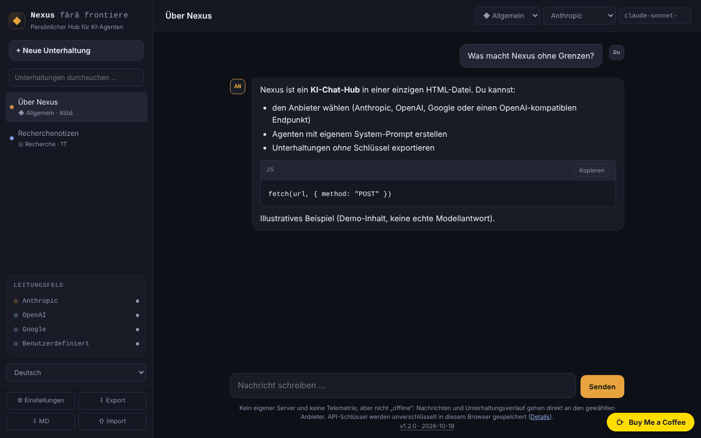

# Nexus fără frontiere

[English](README.md) · [Română](README.ro.md) · [Français](README.fr.md) · [Italiano](README.it.md) · [Español](README.es.md) · [Português](README.pt.md) · **Deutsch** · [Magyar](README.hu.md)

**Version:** 1.2.0 · **Zuletzt aktualisiert:** 2026-10-19

Oberflächensprachen: **Română, English, Français, Italiano, Español, Português (PT), Deutsch, Magyar**

Persönlicher KI-Chat-Hub in einer einzigen HTML-Datei: Du sprichst direkt aus dem Browser mit Anthropic, OpenAI, Google oder einem OpenAI-kompatiblen Endpunkt. **Es ist keine Offline-Anwendung**, und deine Schlüssel liegen unverschlüsselt im Browser — lies den Abschnitt „Datenschutz und Netzwerk“.

**Live-App:** https://chiuta.github.io/Nexus-fara-frontiere/

## Was es ist

Ein Chat-Client ohne eigenen Server: Die Seite hat kein Backend, keine Konten und sendet keine Telemetrie. Du gibst deine eigenen API-Schlüssel ein, und die Anfragen gehen direkt von deinem Browser zum gewählten Anbieter. Ohne Netzwerk und ohne Schlüssel kannst du mit keinem Modell sprechen.

## Funktionen

Im Code und, wo „Test“ steht, in einem Headless-Browser (Chromium/Playwright) mit **simulierten** Antworten geprüft — ich habe keine echten Aufrufe an die APIs der Anbieter durchgeführt.

- Vier Anbieter: Anthropic (Messages API), OpenAI (Chat Completions), Google (Gemini `generateContent`) und „Benutzerdefiniert“ (jeder OpenAI-kompatible Endpunkt: Ollama, LM Studio, OpenRouter usw.).
- SSE-Streaming für Anthropic und für OpenAI/kompatible (Test). **Google streamt nicht**: Die Antwort erscheint am Ende vollständig.
- Schaltfläche „Stopp“ (bricht die Anfrage ab; der Teiltext bleibt, als „gestoppt“ markiert) und automatischer Abbruch nach 5 Minuten ohne jede Antwort.
- Agenten (Personas): Allgemein, Code, Cowork, Recherche + eigene Agenten (Name, System-Prompt, Anbieter, Modell). **„Code“ und „Cowork“ sind nur Personas**: System-Prompts über den öffentlichen Modellen der API, keine Integrationen mit den Produkten Codex oder Claude Cowork.
- Eigenes, minimales Markdown: Überschriften, Listen, fett/kursiv, Inline-Code und Codeblöcke (mit „Kopieren“), `http(s)`-Links. Keine Tabellen, keine Bilder. Jedes HTML in Antworten wird als Text angezeigt; ``-Bilder werden nicht geladen, sodass eine Antwort keine Anfragen an Dritte auslösen kann (Test mit Payloads: ``, `javascript:`, rohes HTML, `<script>`, `<svg onload>`, `<iframe>`).
- Mehrere Unterhaltungen in `localStorage`, bearbeitbarer Titel, Löschen; Suche in der Seitenleiste nach Titel und Text (ohne Beachtung von Diakritika und Groß-/Kleinschreibung).
- „⇩ MD“ speichert die aktuelle Unterhaltung als Markdown-Datei (ohne Schlüssel; ein im Text auftauchender Schlüssel wird maskiert); das Drucken (Strg+P) erzeugt nur die aktuelle Unterhaltung, auf weißem Hintergrund.
- JSON-Export/-Import (Unterhaltungen und Agenten, **ohne Schlüssel**), mit Bereinigung der importierten Datei.
- Die Modellliste ist bearbeitbar und lässt sich mit deinem Schlüssel aus der API des Anbieters neu laden.
- „Schlüssel löschen“ je Anbieter und „Alle lokalen Daten löschen“.
- Anleitung bei der ersten Nutzung: Der leere Zustand weist auf den fehlenden API-Schlüssel hin und öffnet die Einstellungen über eine Schaltfläche; getippter Text geht nicht verloren, wenn der Schlüssel fehlt.
- Ausdrückliche Fehlermeldungen für 401, 403, 404, 429 (mit `Retry-After`, wenn der Anbieter es bereitstellt), 5xx, Fehler mitten im Stream sowie Netzwerk/CORS/CSP (Test).

## Bedienungsanleitung

1. Öffne die Seite (oder `index.html` lokal) und klicke auf **⚙ Einstellungen**.
2. Lies den Warnhinweis oben und füge dann den API-Schlüssel für den gewünschten Anbieter ein (die Schaltfläche „anzeigen“ macht ihn sichtbar). Verwende einen eigenen Schlüssel mit Ausgabenlimit.
3. Klicke auf **Verbindung testen** (sendet eine minimale Anfrage und bricht sie beim ersten Textfragment ab).
4. Existiert der vorgeschlagene Modellname nicht mehr, klicke auf **Modellliste aktualisieren** oder schreibe den Namen direkt in das Feld „Modell“.
5. Schließe die Einstellungen, klicke auf **+ Neue Unterhaltung**, wähle Agent, Anbieter und Modell in der oberen Leiste und schreibe die Nachricht (Eingabe sendet, Umschalt+Eingabe neue Zeile).
6. **Stopp** unterbricht eine laufende Antwort.
7. **Export** speichert die Unterhaltungen und Agenten in einer JSON-Datei; **Import** fügt sie aus einer Datei hinzu (ersetzt nicht). Importiere nur Dateien, denen du vertraust: Der Prompt eines importierten Agenten beeinflusst die Antworten des Modells.

## Datenschutz und Netzwerk

**Was im Browser bleibt**
- `localStorage`: die Unterhaltungen, die Agenten, die Einstellungen und **die API-Schlüssel im Klartext (unverschlüsselt)**. Ist `localStorage` gesperrt oder voll (z. B. privater Modus), läuft die Anwendung im Speicher und warnt dich, dass nichts gespeichert wird.
- Die Schlüssel können von jedem mit Zugriff auf das Browserprofil, von bösartigen Erweiterungen oder durch ein mögliches XSS gelesen werden. Getroffene Maßnahmen: CSP (unten), der gesamte Inhalt der Antworten wird maskiert (escaped), der Import wird bereinigt. Sie beseitigen das Risiko nicht: Nutze die Anwendung nicht auf öffentlichen/gemeinsam genutzten Rechnern, verwende eigene Schlüssel und widerrufe sie im Zweifel.
- Der Export enthält keine Schlüssel (geprüft; erscheint ein gespeicherter Schlüssel dennoch im Text einer Unterhaltung, wird er beim Export maskiert). Exportierte Unterhaltungen können alles enthalten, was du geschrieben hast.

**Was den Browser verlässt und wohin** (nur wenn du eine Nachricht sendest, die Verbindung testest oder die Modellliste aktualisierst)
- Anthropic: `https://api.anthropic.com/v1/messages` und `/v1/models`. Der Schlüssel geht im Header `x-api-key` mit.
- OpenAI: `https://api.openai.com/v1/chat/completions` und `/v1/models`. Header `Authorization: Bearer …`.
- Google: `https://generativelanguage.googleapis.com/v1beta/models/<model>:generateContent` und `/v1beta/models`. Der Schlüssel geht im Header `x-goog-api-key` mit (nicht in der URL).
- Benutzerdefiniert: deine URL + `/v1/chat/completions` und `/v1/models`; der Schlüssel, falls du einen setzt, geht als Bearer an diese URL. `http://` wird nur für `localhost`/`127.0.0.1` akzeptiert.
- Mit jeder Nachricht werden dem Anbieter gesendet: der Schlüssel, der System-Prompt des Agenten und der Verlauf der Unterhaltung (die letzten 100 Nachrichten, höchstens ~300.000 Zeichen; wird gekürzt, teilt dir die Anwendung das mit). Es gelten die Datenrichtlinien des gewählten Anbieters.
- Es gibt keine weiteren Hosts: keine Telemetrie, kein CDN, keine externe Schrift und kein externes Skript. Links in Antworten öffnen sich nur per Klick (`noopener noreferrer`), und die Seite fordert `referrer: no-referrer` an.

**Der Header `anthropic-dangerous-direct-browser-access`**: Die Anthropic-API lehnt CORS-Aufrufe aus dem Browser standardmäßig ab, gerade weil ein Schlüssel in einer Webseite riskant ist. Der Header ist deine ausdrückliche Bestätigung, dass du dieses Risiko akzeptierst. Die Anwendung sendet ihn, da sie sonst aus einer einzigen HTML-Datei nicht mit Anthropic sprechen kann.

**Content-Security-Policy** (in `<meta>`): Skripte sind nur auf Grundlage des Hashes des Seitenskripts erlaubt (keine `<script>`-Injektion wird ausgeführt); `connect-src` ist auf die drei APIs plus `localhost`/`127.0.0.1` (beliebiger Port) beschränkt; keine externen Bilder, Schriften, iframes oder Formulare. Inline-Stile sind erlaubt (`style-src 'unsafe-inline'`), weil die Anwendung `style`-Attribute erzeugt.

### Externer benutzerdefinierter Endpunkt (OpenRouter, DeepSeek, Mistral usw.)

Mit der ausgelieferten CSP funktioniert ein benutzerdefinierter Endpunkt nur auf `localhost`/`127.0.0.1`. Für einen externen Host muss die CSP gelockert werden — und das schwächt den Schutz der Schlüssel (ein eingeschleustes Skript könnte die Schlüssel an diesen Host senden, solange das Skript ausgeführt werden kann; der Hash in `script-src` verhindert das, aber die Verteidigung ist einschichtig). Wenn du es dennoch willst:

1. Lade `index.html` herunter und öffne sie in einem Editor.
2. Füge im Tag `<meta http-equiv="Content-Security-Policy" …>` deinen Host zu `connect-src` hinzu, zum Beispiel `https://openrouter.ai`.
3. **Ändere nichts im `<script>`-Block**: Der Hash in der CSP würde nicht mehr passen, und die Seite startet nicht mehr. Wenn du das Skript änderst, berechne den SHA-256-Hash neu und ersetze ihn in `script-src`.
4. Öffne die Datei lokal (oder veröffentliche deine eigene Kopie).

Für Ollama: Starte es mit der auf den Ursprung der Seite gesetzten Variable `OLLAMA_ORIGINS` (z. B. `https://chiuta.github.io`), sonst blockiert der Browser die Antwort (CORS). Von der über HTTPS veröffentlichten Seite aus erlauben Browser `http://localhost` als Ausnahme; eine Adresse im lokalen Netz `http://192.168.x.x` nicht.

## Grenzen und Warnungen

- Modellnamen ändern sich oft. Die Vorschläge in der Anwendung (Anthropic: `claude-sonnet-5-5`, `claude-opus-5-5`, `claude-haiku-5-5`, `claude-fable-5-1`; OpenAI: `gpt-6-astra`, `gpt-6.1-sol`, `gpt-6-luna`; Google: `gemini-3.8-flash`, `gemini-3.1-pro-preview`, `gemini-3.5-flash`, `gemini-3.1-flash-lite`) wurden am 2026-10-08 manuell in den offiziellen Dokumentationen geprüft und können veraltet sein; ich garantiere weder ihre Verfügbarkeit für dein Konto noch die Preise. Wenn du eine ältere Version verwendet hast, können die in den Einstellungen und in alten Unterhaltungen gespeicherten Modelle nicht mehr existieren: Ändere sie.
- Ich habe nicht mit den echten APIs getestet (nur mit simulierten Antworten). Es können reale Eigenheiten der Anbieter auftreten (CORS bei bestimmten Endpunkten, von einigen Modellen abgelehnte Parameter).
- Feste Grenze von 4096 Ausgabe-Tokens bei Anthropic. Keine Tool-Aufrufe, keine Anhänge/Bilder, keine Websuche.
- Lange Unterhaltungen: Es werden nur die letzten Nachrichten gesendet (siehe oben); `localStorage` hat üblicherweise ~5 MB — bei Überschreitung erhältst du eine Warnung, und die Unterhaltungen werden nicht mehr gespeichert: Exportiere sie.
- Die Antwort eines Modells kann falsch, erfunden oder unpassend sein; prüfe sie, bevor du dich darauf verlässt. Der Text eines angezeigten Links kann von der echten Adresse abweichen (die Adresse erscheint beim Überfahren mit dem Mauszeiger, im `title`).
- Die Kosten der Aufrufe trägst du selbst; die Anwendung begrenzt die Ausgaben nicht.
- Persönliches Projekt, angeboten „wie besehen“, ohne Gewährleistung.

## Lokale Ausführung / offline

Lade `index.html` herunter und öffne sie im Browser. Die Seite startet ohne Internet, aber der Chat benötigt ein Netzwerk (oder ein lokales Modell, z. B. Ollama auf `localhost`).

## Verlauf / Changelog

### 1.1.0 — 2026-10-14
- Datensicherung und Datenkennzeichnung (fff-kit).

### 1.0.0 — 12. Oktober 2026
- Die Version und das Datum der letzten Aktualisierung werden in der Anwendung angezeigt (unter dem Nachrichtenfeld).

### 11.10.2026 (dritte Aktualisierung) — 11. Oktober 2026
- Behoben: Wenn du die erste Nachricht ohne API-Schlüssel (oder ohne Endpunkt/Modell) gesendet hast, ging der getippte Text verloren; jetzt bleibt er im Eingabefeld, und die Benachrichtigung weist darauf hin.
- Der leere Zustand zeigt einen Startschritt mit einer Schaltfläche „Einstellungen öffnen“, solange kein Anbieter einen gespeicherten Schlüssel (oder Endpunkt) hat; er verschwindet, sobald du einen hinzufügst.

### 11.10.2026 (zweite Aktualisierung) — 11. Oktober 2026
- Suche in Unterhaltungen (Titel und Text), Export der aktuellen Unterhaltung als Markdown und Druckstil für die Unterhaltung.

### 11.10.2026 — 11. Oktober 2026
- Barrierefreiheit: eine einzige h1-Überschrift im Hauptbereich (die in der Seitenleiste war auf dem Handy verborgen); axe-Prüfung ohne Verstöße bei 1280 und 360 px.
- Die Modellvorschläge bleiben die am 2026-10-08 geprüften (das Datum erscheint in der Anwendung); sie wurden am 11.10.2026 nicht erneut geprüft — prüfe die Liste in den Einstellungen oder mit „Modellliste aktualisieren“.

## Lizenz

MIT — siehe Datei LICENSE.

## Autor

Alexio — Alexandru-Ionuț Chiuță, Kontakt: alexio@trom.tf

## Zusammenfassung

Nexus fără frontiere ist ein rumänischsprachiger Multi-Anbieter-KI-Chat-Client in einer einzigen Datei: Anthropic, OpenAI, Google Gemini oder jeder OpenAI-kompatible Endpunkt, direkt aus deinem Browser aufgerufen (SSE-Streaming für Anthropic und OpenAI-kompatible; Gemini streamt nicht). Er hat keinen Server und keine Telemetrie, ist aber nicht offline: Nachrichten und Verlauf gehen direkt an den gewählten Anbieter, und API-Schlüssel werden unverschlüsselt in localStorage gespeichert. Eine strenge CSP beschränkt Verbindungen auf die drei APIs plus localhost; externe benutzerdefinierte Endpunkte erfordern die Bearbeitung der CSP in einer lokalen Kopie (dokumentiert). Markdown wird von einem kleinen, maskierenden Renderer dargestellt (gegen XSS-Payloads getestet); der Export enthält keine Schlüssel. „Code“ und „Cowork“ sind Personas, keine Integrationen. Nur mit simulierten API-Antworten getestet.
