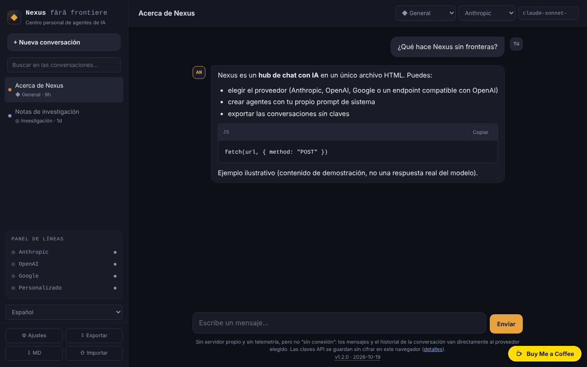

# Nexus fără frontiere

[English](README.md) · [Română](README.ro.md) · [Français](README.fr.md) · [Italiano](README.it.md) · **Español** · [Português](README.pt.md) · [Deutsch](README.de.md) · [Magyar](README.hu.md)

**Versión:** 1.2.7 · **Última actualización:** 2026-10-23

Idiomas de la interfaz: **Română, English, Français, Italiano, Español, Português (PT), Deutsch, Magyar**

Centro personal de chat con IA en un único archivo HTML: hablas directamente desde el navegador con Anthropic, OpenAI, Google o con un endpoint compatible con OpenAI. **No es una aplicación sin conexión** y tus claves permanecen en el navegador, sin cifrar — lee la sección «Privacidad y red».

**Aplicación en línea:** https://chiuta.github.io/Nexus-fara-frontiere/

## Qué es

Un cliente de chat sin servidor propio: la página no tiene backend, no tiene cuentas y no envía telemetría. Introduces tus propias claves API y las solicitudes salen directamente de tu navegador hacia el proveedor elegido. Sin red y sin clave no puedes hablar con ningún modelo.

## Funciones

Verificadas en el código y, donde dice «prueba», en un navegador sin interfaz (Chromium/Playwright) con respuestas **simuladas** — no he realizado llamadas reales a las API de los proveedores.

- Cuatro proveedores: Anthropic (Messages API), OpenAI (Chat Completions), Google (Gemini `generateContent`) y «Personalizado» (cualquier endpoint compatible con OpenAI: Ollama, LM Studio, OpenRouter, etc.).
- Streaming SSE para Anthropic y para OpenAI/compatibles (prueba). **Google no hace streaming**: la respuesta aparece completa, al final.
- Botón «Detener» (cancela la solicitud; el texto parcial permanece, marcado «detenido») e interrupción automática tras 5 minutos sin ninguna respuesta.
- Agentes (personas): General, Código, Cowork, Investigación + agentes propios (nombre, prompt de sistema, proveedor, modelo). **«Código» y «Cowork» son solo personas**: prompts de sistema sobre los modelos públicos de la API, no integraciones con los productos Codex o Claude Cowork.
- Markdown propio, mínimo: títulos, listas, negrita/cursiva, código en línea y bloques de código (con «Copiar»), enlaces `http(s)`. Sin tablas, sin imágenes. Cualquier HTML de las respuestas se muestra como texto; las imágenes `` no se cargan, de modo que una respuesta no puede desencadenar solicitudes a terceros (prueba con cargas útiles: ``, `javascript:`, HTML sin procesar, `<script>`, `<svg onload>`, `<iframe>`).
- Múltiples conversaciones en `localStorage`, título editable, eliminación; búsqueda en la barra lateral por título y texto (sin distinguir diacríticos ni mayúsculas).
- «⇩ MD» guarda la conversación actual como archivo Markdown (sin claves; una clave que aparezca en el texto se enmascara); la impresión (Ctrl+P) produce solo la conversación actual, sobre fondo blanco.
- Exportación/importación JSON (conversaciones y agentes, **sin claves**), con saneamiento del archivo importado.
- Lista de modelos editable y recargable desde la API del proveedor, con tu clave.
- «Borrar la clave» por proveedor y «Borrar todos los datos locales».
- Orientación en el primer uso: el estado vacío señala la falta de clave API y abre los Ajustes desde un botón; el texto escrito no se pierde si falta la clave.
- Mensajes de error explícitos para 401, 403, 404, 429 (con `Retry-After` si el proveedor lo expone), 5xx, errores a mitad del stream y red/CORS/CSP (prueba).

## Manual de uso

1. Abre la página (o `index.html` en local) y pulsa **⚙ Ajustes**.
2. Lee la advertencia de arriba y pega la clave API del proveedor deseado (el botón «mostrar» la revela). Usa una clave dedicada, con límite de gasto.
3. Pulsa **Probar la conexión** (hace una solicitud mínima y la interrumpe al primer fragmento de texto).
4. Si el nombre de modelo sugerido ya no existe, pulsa **Actualizar la lista de modelos** o escribe directamente el nombre en el campo «Modelo».
5. Cierra los Ajustes, pulsa **+ Nueva conversación**, elige el agente, el proveedor y el modelo en la barra superior y escribe el mensaje (Intro envía, Mayús+Intro nueva línea).
6. **Detener** interrumpe una respuesta en curso.
7. **Exportar** guarda las conversaciones y los agentes en un archivo JSON; **Importar** los añade (no reemplaza) desde un archivo. Importa solo archivos de confianza: el prompt de un agente importado influye en las respuestas del modelo.

## Privacidad y red

**Lo que permanece en el navegador**
- `localStorage`: las conversaciones, los agentes, los ajustes y **las claves API, en claro (sin cifrar)**. Si `localStorage` está bloqueado o lleno (p. ej. modo privado), la aplicación funciona en memoria y te avisa de que no se guarda nada.
- Las claves pueden ser leídas por cualquiera con acceso al perfil del navegador, por extensiones maliciosas o por un posible XSS. Medidas tomadas: CSP (abajo), todo el contenido de las respuestas se escapa, la importación se sanea. No eliminan el riesgo: no uses la aplicación en ordenadores públicos/compartidos, usa claves dedicadas y revócalas si dudas.
- La exportación no contiene claves (verificado; si una clave guardada aparece, no obstante, en el texto de una conversación, se enmascara al exportar). Las conversaciones exportadas pueden contener cualquier cosa que hayas escrito.

**Lo que sale del navegador y adónde** (solo cuando envías un mensaje, pruebas la conexión o actualizas la lista de modelos)
- Anthropic: `https://api.anthropic.com/v1/messages` y `/v1/models`. La clave va en la cabecera `x-api-key`.
- OpenAI: `https://api.openai.com/v1/chat/completions` y `/v1/models`. Cabecera `Authorization: Bearer …`.
- Google: `https://generativelanguage.googleapis.com/v1beta/models/<model>:generateContent` y `/v1beta/models`. La clave va en la cabecera `x-goog-api-key` (no en la URL).
- Personalizado: tu URL + `/v1/chat/completions` y `/v1/models`; la clave, si la pones, va como Bearer a esa URL. `http://` solo se acepta para `localhost`/`127.0.0.1`.
- Con cada mensaje se envían al proveedor: la clave, el prompt de sistema del agente y el historial de la conversación (los últimos 100 mensajes, como máximo ~300 000 caracteres; si se trunca, la aplicación te avisa). Se aplican las políticas de datos del proveedor elegido.
- No hay otros hosts: ninguna telemetría, ningún CDN, ninguna fuente ni script externo. Los enlaces de las respuestas se abren solo al hacer clic (`noopener noreferrer`), y la página solicita `referrer: no-referrer`.

**La cabecera `anthropic-dangerous-direct-browser-access`**: la API de Anthropic rechaza por defecto las llamadas CORS desde el navegador, precisamente porque una clave en una página web es arriesgada. La cabecera es la confirmación explícita, por tu parte, de que aceptas este riesgo. La aplicación la envía porque, de otro modo, no puede hablar con Anthropic desde un único archivo HTML.

**Content-Security-Policy** (en `<meta>`): los scripts solo se permiten sobre la base del hash del script de la página (no se ejecuta ninguna inyección de `<script>`); `connect-src` se limita a las tres API más `localhost`/`127.0.0.1` (cualquier puerto); sin imágenes, fuentes, iframes ni formularios externos. Los estilos en línea están permitidos (`style-src 'unsafe-inline'`), porque la aplicación genera atributos `style`.

### 1.2.1 — 2026-10-22
- El título de la página y las metaetiquetas de descripción/Open Graph siguen el idioma de la interfaz.

### Endpoint personalizado externo (OpenRouter, DeepSeek, Mistral, etc.)

Con la CSP incluida, un endpoint personalizado solo funciona en `localhost`/`127.0.0.1`. Para un host externo hay que relajar la CSP — y eso debilita la protección de las claves (un script inyectado podría enviar las claves a ese host, mientras el script pueda ejecutarse; el hash de `script-src` lo impide, pero la defensa es de una sola capa). Si aun así lo quieres:

1. Descarga `index.html` y ábrelo en un editor.
2. En la etiqueta `<meta http-equiv="Content-Security-Policy" …>` añade tu host a `connect-src`, por ejemplo `https://openrouter.ai`.
3. **No modifiques nada en el bloque `<script>`**: el hash de la CSP dejaría de coincidir y la página no arrancaría. Si modificas el script, recalcula el hash SHA-256 y sustitúyelo en `script-src`.
4. Abre el archivo en local (o publica tu propia copia).

Para Ollama: arráncalo con la variable `OLLAMA_ORIGINS` establecida en el origen de la página (p. ej. `https://chiuta.github.io`), de lo contrario el navegador bloquea la respuesta (CORS). Desde la página publicada por HTTPS, `http://localhost` está permitido por los navegadores como excepción; una dirección de red local `http://192.168.x.x` no.

## Límites y advertencias

- Los nombres de los modelos cambian con frecuencia. Las sugerencias de la aplicación (Anthropic: `claude-sonnet-5-5`, `claude-opus-5-5`, `claude-haiku-5-5`, `claude-fable-5-1`; OpenAI: `gpt-6-astra`, `gpt-6.1-sol`, `gpt-6-luna`; Google: `gemini-3.8-flash`, `gemini-3.1-pro-preview`, `gemini-3.5-flash`, `gemini-3.1-flash-lite`) se verificaron manualmente en las documentaciones oficiales el 2026-10-08 y pueden estar desfasadas; no garantizo su disponibilidad para tu cuenta ni las tarifas. Si usaste una versión anterior, los modelos guardados en Ajustes y en conversaciones antiguas pueden no existir ya: cámbialos.
- No he probado con las API reales (solo usé respuestas simuladas). Pueden aparecer particularidades reales de los proveedores (CORS en ciertos endpoints, parámetros rechazados por algunos modelos).
- Límite fijo de 4096 tokens de salida en Anthropic. Sin llamadas a herramientas, sin adjuntos/imágenes, sin búsqueda web.
- Conversaciones largas: solo se envían los últimos mensajes (véase arriba); `localStorage` suele tener ~5 MB — al superarlo recibes un aviso y las conversaciones dejan de guardarse: expórtalas.
- La respuesta de un modelo puede ser errónea, inventada o inapropiada; compruébala antes de fiarte de ella. El texto de un enlace mostrado puede diferir de la dirección real (la dirección aparece al pasar el cursor, en `title`).
- Los costes de las llamadas corren por tu cuenta; la aplicación no limita el gasto.
- Proyecto personal, ofrecido «tal cual», sin garantías.

## Ejecución local / sin conexión

Descarga `index.html` y ábrelo en el navegador. La página arranca sin internet, pero el chat requiere red (o un modelo local, p. ej. Ollama en `localhost`).

## Historial / Changelog

### 1.2.7 — 2026-10-23

Touch targets of at least 44 px for the main controls on touch screens (sidebar button, title, agent/provider/model fields, empty-state buttons, delete conversation).

### 1.2.5 — 2026-10-22

fff-kit 1.1.4: áreas táctiles y texto mínimo.

### 1.2.4 — 2026-10-22

fff-kit 1.1.2: PBKDF2 con 600.000 iteraciones, protección anti-clickjacking.

- 1.2.3 — 2026-10-22: Los dos window.confirm (borrar conversación, borrar todos los datos) se sustituyen por diálogos integrados; los títulos de las respuestas del modelo ya no crean h1/h2 adicionales en la página; texto ≥ 12 px y enlaces del pie más grandes en móvil.

- 1.2.2 — 2026-10-22: **corrección**: el texto de ejemplo del campo «URL base» («o») sigue ahora el idioma elegido.
### 1.1.0 — 2026-10-14
- Copia de seguridad y etiquetado de datos (fff-kit).

### 1.0.0 — 12 de octubre de 2026
- La versión y la fecha de la última actualización se muestran en la aplicación (bajo el campo de mensaje).

### 11.10.2026 (tercera actualización) — 11 de octubre de 2026
- Corregido: si enviabas el primer mensaje sin clave API (o sin endpoint/modelo), el texto escrito se perdía; ahora permanece en el campo de escritura y la notificación lo indica.
- El estado vacío muestra un paso de inicio con un botón «Abrir Ajustes» mientras ningún proveedor tenga una clave (o endpoint) guardada; desaparece cuando añades una.

### 11.10.2026 (segunda actualización) — 11 de octubre de 2026
- Búsqueda en conversaciones (título y texto), exportación de la conversación actual a Markdown y estilo de impresión para la conversación.

### 11.10.2026 — 11 de octubre de 2026
- Accesibilidad: un único encabezado h1 en el área principal (el de la barra lateral estaba oculto en móvil); verificación axe sin infracciones a 1280 y 360 px.
- Las sugerencias de modelos siguen siendo las verificadas el 2026-10-08 (la fecha aparece en la aplicación); no se han vuelto a verificar el 11.10.2026 — comprueba la lista en Ajustes o con «Actualizar la lista de modelos».

## Licencia

MIT — véase el archivo LICENSE.

## Autor

Alexio — Alexandru-Ionuț Chiuță, contacto: alexio@trom.tf

## Resumen

Nexus fără frontiere es un cliente de chat con IA multiproveedor en rumano, en un único archivo: Anthropic, OpenAI, Google Gemini o cualquier endpoint compatible con OpenAI, llamados directamente desde tu navegador (streaming SSE para Anthropic y compatibles con OpenAI; Gemini no hace streaming). No tiene servidor ni telemetría, pero no es sin conexión: los mensajes y el historial van directamente al proveedor que elijas, y las claves API se guardan sin cifrar en localStorage. Una CSP estricta limita las conexiones a las tres API más localhost; los endpoints personalizados externos exigen editar la CSP en una copia local (documentado). El Markdown lo muestra un pequeño renderizador con escape (probado contra cargas XSS); la exportación no contiene claves. «Código» y «Cowork» son personas, no integraciones. Probado solo con respuestas de API simuladas.
