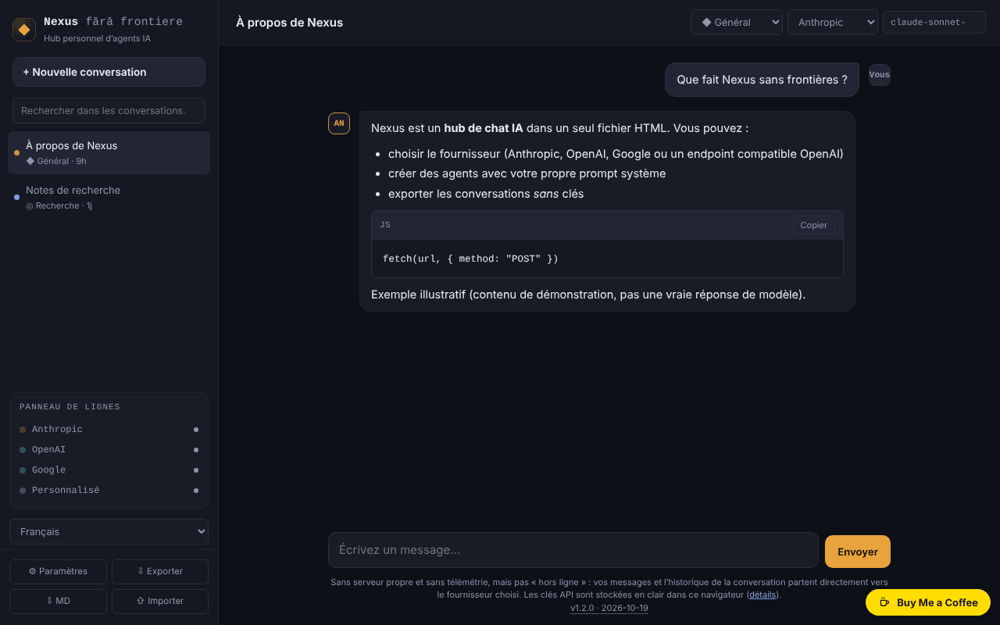

# Nexus fără frontiere

[English](README.md) · [Română](README.ro.md) · **Français** · [Italiano](README.it.md) · [Español](README.es.md) · [Português](README.pt.md) · [Deutsch](README.de.md) · [Magyar](README.hu.md)

**Version :** 1.2.6 · **Dernière mise à jour :** 2026-10-23

Langues de l'interface : **Română, English, Français, Italiano, Español, Português (PT), Deutsch, Magyar**

Hub personnel de chat IA dans un seul fichier HTML : vous parlez directement depuis le navigateur avec Anthropic, OpenAI, Google ou un point de terminaison compatible OpenAI. **Ce n'est pas une application hors ligne** et vos clés restent dans le navigateur, non chiffrées — lisez la section « Confidentialité et réseau ».

**Application en ligne :** https://chiuta.github.io/Nexus-fara-frontiere/

## De quoi s'agit-il

Un client de chat sans serveur propre : la page n'a pas de backend, pas de comptes et n'envoie aucune télémétrie. Vous saisissez vos propres clés API, et les requêtes partent directement de votre navigateur vers le fournisseur choisi. Sans réseau et sans clé, vous ne pouvez parler à aucun modèle.

## Fonctions

Vérifiées dans le code et, là où il est écrit « test », dans un navigateur sans interface (Chromium/Playwright) avec des réponses **simulées** — je n'ai pas effectué d'appels réels aux API des fournisseurs.

- Quatre fournisseurs : Anthropic (Messages API), OpenAI (Chat Completions), Google (Gemini `generateContent`) et « Personnalisé » (tout point de terminaison compatible OpenAI : Ollama, LM Studio, OpenRouter, etc.).
- Streaming SSE pour Anthropic et pour OpenAI/compatibles (test). **Google ne fait pas de streaming** : la réponse apparaît en entier, à la fin.
- Bouton « Arrêter » (annule la requête ; le texte partiel reste, marqué « arrêté ») et interruption automatique après 5 minutes sans aucune réponse.
- Agents (personas) : Général, Code, Cowork, Recherche + agents personnalisés (nom, prompt système, fournisseur, modèle). **« Code » et « Cowork » ne sont que des personas** : des prompts système posés sur les modèles publics de l'API, et non des intégrations avec les produits Codex ou Claude Cowork.
- Markdown propre, minimal : titres, listes, gras/italique, code en ligne et blocs de code (avec « Copier »), liens `http(s)`. Pas de tableaux, pas d'images. Tout HTML dans les réponses est affiché comme du texte ; les images `` ne se chargent pas, donc une réponse ne peut pas déclencher de requêtes vers des tiers (test avec des charges utiles : ``, `javascript:`, HTML brut, `<script>`, `<svg onload>`, `<iframe>`).
- Conversations multiples dans `localStorage`, titre modifiable, suppression ; recherche dans la barre latérale par titre et texte (insensible aux diacritiques et à la casse).
- « ⇩ MD » enregistre la conversation courante en fichier Markdown (sans clés ; une clé apparaissant dans le texte est masquée) ; l'impression (Ctrl+P) ne produit que la conversation courante, sur fond blanc.
- Export/import JSON (conversations et agents, **sans clés**), avec assainissement du fichier importé.
- Liste de modèles modifiable et rechargeable depuis l'API du fournisseur, avec votre clé.
- « Supprimer la clé » par fournisseur et « Supprimer toutes les données locales ».
- Guidage à la première utilisation : l'état vide signale l'absence de clé API et ouvre les Paramètres depuis un bouton ; le texte saisi n'est pas perdu si la clé manque.
- Messages d'erreur explicites pour 401, 403, 404, 429 (avec `Retry-After` si le fournisseur l'expose), 5xx, erreurs en milieu de flux et réseau/CORS/CSP (test).

## Mode d'emploi

1. Ouvrez la page (ou `index.html` en local) et appuyez sur **⚙ Paramètres**.
2. Lisez l'avertissement du haut, puis collez la clé API du fournisseur souhaité (le bouton « afficher » la révèle). Utilisez une clé dédiée, avec un plafond de dépenses.
3. Appuyez sur **Tester la connexion** (elle fait une requête minimale et l'interrompt au premier fragment de texte).
4. Si le nom de modèle suggéré n'existe plus, appuyez sur **Actualiser la liste des modèles** ou écrivez directement le nom dans le champ « Modèle ».
5. Fermez les Paramètres, appuyez sur **+ Nouvelle conversation**, choisissez l'agent, le fournisseur et le modèle dans la barre du haut et écrivez le message (Entrée envoie, Maj+Entrée nouvelle ligne).
6. **Arrêter** interrompt une réponse en cours.
7. **Exporter** enregistre les conversations et les agents dans un fichier JSON ; **Importer** les ajoute (sans remplacer) depuis un fichier. N'importez que des fichiers de confiance : le prompt d'un agent importé influence les réponses du modèle.

## Confidentialité et réseau

**Ce qui reste dans le navigateur**
- `localStorage` : les conversations, les agents, les paramètres et **les clés API, en clair (non chiffrées)**. Si `localStorage` est bloqué ou plein (ex. mode privé), l'application fonctionne en mémoire et vous avertit que rien n'est enregistré.
- Les clés peuvent être lues par toute personne ayant accès au profil du navigateur, par des extensions malveillantes ou par un éventuel XSS. Mesures prises : CSP (ci-dessous), tout le contenu des réponses est échappé, l'import est assaini. Cela n'élimine pas le risque : n'utilisez pas l'application sur des ordinateurs publics/partagés, utilisez des clés dédiées et révoquez-les en cas de doute.
- L'export ne contient pas de clés (vérifié ; si une clé enregistrée apparaît malgré tout dans le texte d'une conversation, elle est masquée à l'export). Les conversations exportées peuvent contenir tout ce que vous avez écrit.

**Ce qui quitte le navigateur et où** (uniquement lorsque vous envoyez un message, testez la connexion ou actualisez la liste des modèles)
- Anthropic : `https://api.anthropic.com/v1/messages` et `/v1/models`. La clé va dans l'en-tête `x-api-key`.
- OpenAI : `https://api.openai.com/v1/chat/completions` et `/v1/models`. En-tête `Authorization: Bearer …`.
- Google : `https://generativelanguage.googleapis.com/v1beta/models/<model>:generateContent` et `/v1beta/models`. La clé va dans l'en-tête `x-goog-api-key` (pas dans l'URL).
- Personnalisé : votre URL + `/v1/chat/completions` et `/v1/models` ; la clé, si vous en mettez une, va en Bearer vers cette URL. `http://` n'est accepté que pour `localhost`/`127.0.0.1`.
- À chaque message sont envoyés au fournisseur : la clé, le prompt système de l'agent et l'historique de la conversation (les 100 derniers messages, au maximum ~300 000 caractères ; en cas de troncature, l'application vous le signale). Les politiques de données du fournisseur choisi s'appliquent.
- Il n'y a pas d'autres hôtes : aucune télémétrie, aucun CDN, aucune police ni script externe. Les liens des réponses ne s'ouvrent qu'au clic (`noopener noreferrer`), et la page demande `referrer: no-referrer`.

**L'en-tête `anthropic-dangerous-direct-browser-access`** : l'API Anthropic refuse par défaut les appels CORS depuis le navigateur, précisément parce qu'une clé dans une page web est risquée. L'en-tête est la confirmation explicite, de votre part, que vous acceptez ce risque. L'application l'envoie car, sinon, elle ne peut pas parler à Anthropic depuis un seul fichier HTML.

**Content-Security-Policy** (dans `<meta>`) : les scripts ne sont autorisés que sur la base du hash du script de la page (aucune injection de `<script>` ne s'exécute) ; `connect-src` est limité aux trois API plus `localhost`/`127.0.0.1` (n'importe quel port) ; pas d'images, polices, iframes ou formulaires externes. Les styles en ligne sont autorisés (`style-src 'unsafe-inline'`), car l'application génère des attributs `style`.

### 1.2.1 — 2026-10-22
- Le titre de la page et les balises meta de description/Open Graph suivent la langue de l'interface.

### Point de terminaison personnalisé externe (OpenRouter, DeepSeek, Mistral, etc.)

Avec la CSP livrée, un point de terminaison personnalisé ne fonctionne que sur `localhost`/`127.0.0.1`. Pour un hôte externe, la CSP doit être assouplie — ce qui affaiblit la protection des clés (un script injecté pourrait envoyer les clés vers cet hôte, tant que le script peut s'exécuter ; le hash de `script-src` l'en empêche, mais la défense repose sur une seule couche). Si vous le souhaitez malgré tout :

1. Téléchargez `index.html` et ouvrez-le dans un éditeur.
2. Dans la balise `<meta http-equiv="Content-Security-Policy" …>`, ajoutez votre hôte à `connect-src`, par exemple `https://openrouter.ai`.
3. **Ne modifiez rien dans le bloc `<script>`** : le hash de la CSP ne correspondrait plus et la page ne démarrerait plus. Si vous modifiez le script, recalculez le hash SHA-256 et remplacez-le dans `script-src`.
4. Ouvrez le fichier en local (ou publiez votre propre copie).

Pour Ollama : démarrez-le avec la variable `OLLAMA_ORIGINS` définie sur l'origine de la page (ex. `https://chiuta.github.io`), sinon le navigateur bloque la réponse (CORS). Depuis la page publiée en HTTPS, `http://localhost` est autorisé par les navigateurs à titre d'exception ; une adresse de réseau local `http://192.168.x.x` ne l'est pas.

## Limites et avertissements

- Les noms de modèles changent souvent. Les suggestions de l'application (Anthropic : `claude-sonnet-5-5`, `claude-opus-5-5`, `claude-haiku-5-5`, `claude-fable-5-1` ; OpenAI : `gpt-6-astra`, `gpt-6.1-sol`, `gpt-6-luna` ; Google : `gemini-3.8-flash`, `gemini-3.1-pro-preview`, `gemini-3.5-flash`, `gemini-3.1-flash-lite`) ont été vérifiées manuellement dans les documentations officielles le 2026-10-08 et peuvent être dépassées ; je ne garantis ni leur disponibilité pour votre compte, ni les tarifs. Si vous avez utilisé une version plus ancienne, les modèles enregistrés dans les Paramètres et dans d'anciennes conversations peuvent ne plus exister : changez-les.
- Je n'ai pas testé avec les API réelles (je n'ai utilisé que des réponses simulées). Des particularités réelles des fournisseurs (CORS sur certains points de terminaison, paramètres rejetés par certains modèles) peuvent apparaître.
- Limite fixe de 4096 jetons de sortie pour Anthropic. Pas d'appels d'outils, pas de pièces jointes/images, pas de recherche web.
- Conversations longues : seuls les derniers messages sont envoyés (voir plus haut) ; `localStorage` fait généralement ~5 Mo — en cas de dépassement, vous recevez un avertissement et les conversations ne sont plus enregistrées : exportez-les.
- Une réponse de modèle peut être erronée, inventée ou inappropriée ; vérifiez-la avant de vous y fier. Le texte d'un lien affiché peut différer de l'adresse réelle (l'adresse apparaît au survol, dans `title`).
- Les coûts des appels sont à votre charge ; l'application ne limite pas les dépenses.
- Projet personnel, proposé « en l'état », sans garanties.

## Exécution locale / hors ligne

Téléchargez `index.html` et ouvrez-le dans le navigateur. La page démarre sans internet, mais le chat nécessite un réseau (ou un modèle local, ex. Ollama sur `localhost`).

## Historique / Changelog

### 1.2.5 — 2026-10-22

fff-kit 1.1.4 : cibles tactiles et taille de texte minimale.

### 1.2.4 — 2026-10-22

fff-kit 1.1.2 : PBKDF2 600 000 itérations, protection anti-clickjacking.

- 1.2.3 — 2026-10-22 : Les deux window.confirm (suppression d’une conversation, effacement des données) sont remplacés par des dialogues intégrés ; les titres des réponses du modèle ne créent plus de h1/h2 supplémentaires dans la page ; texte ≥ 12 px et liens du pied de page plus grands sur mobile.

- 1.2.2 — 2026-10-22: **correctif** : le texte d’exemple du champ « URL de base » (« ou ») suit désormais la langue choisie.
### 1.1.0 — 2026-10-14
- Sauvegarde et étiquetage des données (fff-kit).

### 1.0.0 — 12 octobre 2026
- La version et la date de la dernière mise à jour sont affichées dans l'application (sous le champ de message).

### 11.10.2026 (troisième mise à jour) — 11 octobre 2026
- Corrigé : si vous envoyiez le premier message sans clé API (ou sans point de terminaison/modèle), le texte saisi était perdu ; il reste désormais dans le champ de saisie, et la notification l'indique.
- L'état vide affiche une étape de démarrage avec un bouton « Ouvrir les Paramètres » tant qu'aucun fournisseur n'a de clé (ou de point de terminaison) enregistrée ; il disparaît dès que vous en ajoutez une.

### 11.10.2026 (deuxième mise à jour) — 11 octobre 2026
- Recherche dans les conversations (titre et texte), export de la conversation courante en Markdown et style d'impression pour la conversation.

### 11.10.2026 — 11 octobre 2026
- Accessibilité : un seul titre h1 dans la zone principale (celui de la barre latérale était masqué sur mobile) ; vérification axe sans violations à 1280 et 360 px.
- Les suggestions de modèles restent celles vérifiées le 2026-10-08 (la date apparaît dans l'application) ; elles n'ont pas été revérifiées le 11.10.2026 — vérifiez la liste dans les Paramètres ou avec « Actualiser la liste des modèles ».

## Licence

MIT — voir le fichier LICENSE.

## Auteur

Alexio — Alexandru-Ionuț Chiuță, contact : alexio@trom.tf

## Résumé

Nexus fără frontiere est un client de chat IA multi-fournisseurs en roumain, dans un seul fichier : Anthropic, OpenAI, Google Gemini ou tout point de terminaison compatible OpenAI, appelés directement depuis votre navigateur (streaming SSE pour Anthropic et les compatibles OpenAI ; Gemini ne fait pas de streaming). Il n'a ni serveur ni télémétrie, mais il n'est pas hors ligne : messages et historique vont directement au fournisseur que vous choisissez, et les clés API sont stockées non chiffrées dans localStorage. Une CSP stricte limite les connexions aux trois API plus localhost ; les points de terminaison personnalisés externes exigent de modifier la CSP dans une copie locale (documenté). Le Markdown est rendu par un petit moteur à échappement (testé contre des charges XSS) ; l'export ne contient pas de clés. « Code » et « Cowork » sont des personas, pas des intégrations. Testé uniquement avec des réponses d'API simulées.
