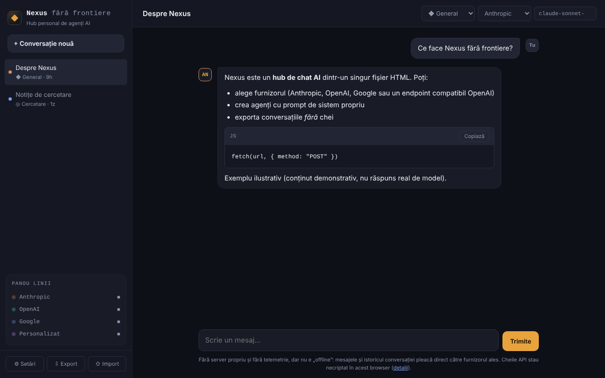

# Nexus fără frontiere

[English](README.md) · [Română](README.ro.md) · [Français](README.fr.md) · **Italiano** · [Español](README.es.md) · [Português](README.pt.md) · [Deutsch](README.de.md) · [Magyar](README.hu.md)

**Versione:** 1.2.0 · **Ultimo aggiornamento:** 2026-10-19

Lingue dell'interfaccia: **Română, English, Français, Italiano, Español, Português (PT), Deutsch, Magyar**

Hub personale di chat IA in un unico file HTML: parli direttamente dal browser con Anthropic, OpenAI, Google o con un endpoint compatibile con OpenAI. **Non è un'applicazione offline** e le tue chiavi restano nel browser, non cifrate — leggi la sezione «Privacy e rete».

**App online:** https://chiuta.github.io/Nexus-fara-frontiere/

## Che cos'è

Un client di chat senza server proprio: la pagina non ha backend, non ha account e non invia telemetria. Inserisci le tue chiavi API e le richieste partono direttamente dal tuo browser verso il fornitore scelto. Senza rete e senza chiave non puoi parlare con nessun modello.

## Funzioni

Verificate nel codice e, dove è scritto «test», in un browser headless (Chromium/Playwright) con risposte **simulate** — non ho eseguito chiamate reali alle API dei fornitori.

- Quattro fornitori: Anthropic (Messages API), OpenAI (Chat Completions), Google (Gemini `generateContent`) e «Personalizzato» (qualsiasi endpoint compatibile con OpenAI: Ollama, LM Studio, OpenRouter ecc.).
- Streaming SSE per Anthropic e per OpenAI/compatibili (test). **Google non fa streaming**: la risposta appare intera, alla fine.
- Pulsante «Interrompi» (annulla la richiesta; il testo parziale resta, contrassegnato «interrotto») e interruzione automatica dopo 5 minuti senza alcuna risposta.
- Agenti (persona): Generale, Codice, Cowork, Ricerca + agenti propri (nome, prompt di sistema, fornitore, modello). **«Codice» e «Cowork» sono solo persona**: prompt di sistema sopra i modelli pubblici dell'API, non integrazioni con i prodotti Codex o Claude Cowork.
- Markdown proprio, minimale: titoli, elenchi, grassetto/corsivo, codice inline e blocchi di codice (con «Copia»), link `http(s)`. Niente tabelle, niente immagini. Qualsiasi HTML nelle risposte viene mostrato come testo; le immagini `` non si caricano, quindi una risposta non può innescare richieste verso terzi (test con payload: ``, `javascript:`, HTML grezzo, `<script>`, `<svg onload>`, `<iframe>`).
- Più conversazioni in `localStorage`, titolo modificabile, eliminazione; ricerca nella barra laterale per titolo e testo (senza distinzione di segni diacritici e maiuscole).
- «⇩ MD» salva la conversazione corrente come file Markdown (senza chiavi; una chiave comparsa nel testo viene mascherata); la stampa (Ctrl+P) produce solo la conversazione corrente, su sfondo bianco.
- Esportazione/importazione JSON (conversazioni e agenti, **senza chiavi**), con sanificazione del file importato.
- Elenco dei modelli modificabile e ricaricabile dall'API del fornitore, con la tua chiave.
- «Elimina la chiave» per fornitore ed «Elimina tutti i dati locali».
- Guida al primo utilizzo: lo stato vuoto segnala la mancanza della chiave API e apre le Impostazioni da un pulsante; il testo digitato non si perde se manca la chiave.
- Messaggi di errore espliciti per 401, 403, 404, 429 (con `Retry-After` se il fornitore lo espone), 5xx, errori a metà dello stream e rete/CORS/CSP (test).

## Guida all'uso

1. Apri la pagina (o `index.html` in locale) e premi **⚙ Impostazioni**.
2. Leggi l'avvertenza in alto, poi incolla la chiave API del fornitore desiderato (il pulsante «mostra» la rivela). Usa una chiave dedicata, con un limite di spesa.
3. Premi **Prova la connessione** (esegue una richiesta minima e la interrompe al primo frammento di testo).
4. Se il nome del modello suggerito non esiste più, premi **Aggiorna l'elenco dei modelli** o scrivi direttamente il nome nel campo «Modello».
5. Chiudi le Impostazioni, premi **+ Nuova conversazione**, scegli l'agente, il fornitore e il modello dalla barra superiore e scrivi il messaggio (Invio invia, Maiusc+Invio nuova riga).
6. **Interrompi** ferma una risposta in corso.
7. **Esporta** salva le conversazioni e gli agenti in un file JSON; **Importa** li aggiunge (non sostituisce) da un file. Importa solo file di cui ti fidi: il prompt di un agente importato influenza le risposte del modello.

## Privacy e rete

**Cosa resta nel browser**
- `localStorage`: le conversazioni, gli agenti, le impostazioni e **le chiavi API, in chiaro (non cifrate)**. Se `localStorage` è bloccato o pieno (ad es. modalità privata), l'applicazione lavora in memoria e ti avvisa che non viene salvato nulla.
- Le chiavi possono essere lette da chiunque abbia accesso al profilo del browser, da estensioni malevole o da un eventuale XSS. Misure adottate: CSP (sotto), tutto il contenuto delle risposte è sottoposto a escape, l'importazione è sanificata. Non eliminano il rischio: non usare l'applicazione su computer pubblici/condivisi, usa chiavi dedicate e revocale in caso di dubbio.
- L'esportazione non contiene chiavi (verificato; se una chiave salvata compare comunque nel testo di una conversazione, viene mascherata all'esportazione). Le conversazioni esportate possono contenere qualsiasi cosa tu abbia scritto.

**Cosa lascia il browser e dove** (solo quando invii un messaggio, provi la connessione o aggiorni l'elenco dei modelli)
- Anthropic: `https://api.anthropic.com/v1/messages` e `/v1/models`. La chiave va nell'intestazione `x-api-key`.
- OpenAI: `https://api.openai.com/v1/chat/completions` e `/v1/models`. Intestazione `Authorization: Bearer …`.
- Google: `https://generativelanguage.googleapis.com/v1beta/models/<model>:generateContent` e `/v1beta/models`. La chiave va nell'intestazione `x-goog-api-key` (non nell'URL).
- Personalizzato: il tuo URL + `/v1/chat/completions` e `/v1/models`; la chiave, se la inserisci, va come Bearer verso quell'URL. `http://` è accettato solo per `localhost`/`127.0.0.1`.
- A ogni messaggio vengono inviati al fornitore: la chiave, il prompt di sistema dell'agente e la cronologia della conversazione (gli ultimi 100 messaggi, al massimo ~300.000 caratteri; se viene troncata, l'applicazione ti avvisa). Si applicano le politiche sui dati del fornitore scelto.
- Non ci sono altri host: nessuna telemetria, nessuna CDN, nessun font o script esterno. I link nelle risposte si aprono solo al clic (`noopener noreferrer`), e la pagina richiede `referrer: no-referrer`.

**L'intestazione `anthropic-dangerous-direct-browser-access`**: l'API di Anthropic rifiuta per impostazione predefinita le chiamate CORS dal browser, proprio perché una chiave in una pagina web è rischiosa. L'intestazione è la conferma esplicita, da parte tua, che accetti questo rischio. L'applicazione la invia perché altrimenti non può parlare con Anthropic da un unico file HTML.

**Content-Security-Policy** (in `<meta>`): gli script sono consentiti solo in base all'hash dello script della pagina (nessuna iniezione di `<script>` viene eseguita); `connect-src` è limitato alle tre API più `localhost`/`127.0.0.1` (qualsiasi porta); niente immagini, font, iframe o moduli esterni. Gli stili inline sono consentiti (`style-src 'unsafe-inline'`), perché l'applicazione genera attributi `style`.

### Endpoint personalizzato esterno (OpenRouter, DeepSeek, Mistral ecc.)

Con la CSP fornita, un endpoint personalizzato funziona solo su `localhost`/`127.0.0.1`. Per un host esterno la CSP deve essere allentata — e ciò indebolisce la protezione delle chiavi (uno script iniettato potrebbe inviare le chiavi a quell'host, finché lo script può essere eseguito; l'hash in `script-src` lo impedisce, ma la difesa è su un solo livello). Se vuoi comunque farlo:

1. Scarica `index.html` e aprilo in un editor.
2. Nel tag `<meta http-equiv="Content-Security-Policy" …>` aggiungi il tuo host a `connect-src`, ad esempio `https://openrouter.ai`.
3. **Non modificare nulla nel blocco `<script>`**: l'hash nella CSP non corrisponderebbe più e la pagina non si avvierebbe. Se modifichi lo script, ricalcola l'hash SHA-256 e sostituiscilo in `script-src`.
4. Apri il file in locale (o pubblica la tua copia).

Per Ollama: avvialo con la variabile `OLLAMA_ORIGINS` impostata sull'origine della pagina (ad es. `https://chiuta.github.io`), altrimenti il browser blocca la risposta (CORS). Dalla pagina pubblicata via HTTPS, `http://localhost` è consentito dai browser come eccezione; un indirizzo di rete locale `http://192.168.x.x` no.

## Limiti e avvertenze

- I nomi dei modelli cambiano spesso. I suggerimenti nell'applicazione (Anthropic: `claude-sonnet-5-5`, `claude-opus-5-5`, `claude-haiku-5-5`, `claude-fable-5-1`; OpenAI: `gpt-6-astra`, `gpt-6.1-sol`, `gpt-6-luna`; Google: `gemini-3.8-flash`, `gemini-3.1-pro-preview`, `gemini-3.5-flash`, `gemini-3.1-flash-lite`) sono stati verificati manualmente nelle documentazioni ufficiali il 2026-10-08 e possono essere superati; non garantisco la loro disponibilità per il tuo account, né le tariffe. Se hai usato una versione più vecchia, i modelli salvati nelle Impostazioni e nelle vecchie conversazioni possono non esistere più: cambiali.
- Non ho testato con le API reali (ho usato solo risposte simulate). Possono presentarsi peculiarità reali dei fornitori (CORS su certi endpoint, parametri respinti da alcuni modelli).
- Limite fisso di 4096 token di output per Anthropic. Niente chiamate a strumenti, niente allegati/immagini, niente ricerca web.
- Conversazioni lunghe: vengono inviati solo gli ultimi messaggi (vedi sopra); `localStorage` ha di solito ~5 MB — in caso di superamento ricevi un avviso e le conversazioni non vengono più salvate: esportale.
- La risposta di un modello può essere sbagliata, inventata o inappropriata; verificala prima di fare affidamento su di essa. Il testo di un link mostrato può differire dall'indirizzo reale (l'indirizzo compare al passaggio del cursore, in `title`).
- I costi delle chiamate sono a tuo carico; l'applicazione non limita la spesa.
- Progetto personale, offerto «così com'è», senza garanzie.

## Esecuzione locale / offline

Scarica `index.html` e aprilo nel browser. La pagina si avvia senza internet, ma la chat richiede una rete (o un modello locale, ad es. Ollama su `localhost`).

## Cronologia / Changelog

### 1.1.0 — 2026-10-14
- Copia di riserva ed etichettatura dei dati (fff-kit).

### 1.0.0 — 12 ottobre 2026
- La versione e la data dell'ultimo aggiornamento sono mostrate nell'applicazione (sotto il campo del messaggio).

### 11.10.2026 (terzo aggiornamento) — 11 ottobre 2026
- Corretto: se inviavi il primo messaggio senza chiave API (o senza endpoint/modello), il testo digitato si perdeva; ora resta nel campo di scrittura e la notifica lo dice.
- Lo stato vuoto mostra un passo iniziale con un pulsante «Apri Impostazioni» finché nessun fornitore ha una chiave (o un endpoint) salvata; scompare dopo che ne aggiungi una.

### 11.10.2026 (secondo aggiornamento) — 11 ottobre 2026
- Ricerca nelle conversazioni (titolo e testo), esportazione della conversazione corrente in Markdown e stile di stampa per la conversazione.

### 11.10.2026 — 11 ottobre 2026
- Accessibilità: un solo titolo h1 nell'area principale (quello nella barra laterale era nascosto su mobile); verifica axe senza violazioni a 1280 e 360 px.
- I suggerimenti di modelli restano quelli verificati il 2026-10-08 (la data compare nell'applicazione); non sono stati ricontrollati l'11.10.2026 — verifica l'elenco nelle Impostazioni o con «Aggiorna l'elenco dei modelli».

## Licenza

MIT — vedi il file LICENSE.

## Autore

Alexio — Alexandru-Ionuț Chiuță, contatto: alexio@trom.tf

## Riepilogo

Nexus fără frontiere è un client di chat IA multi-fornitore in lingua romena, in un unico file: Anthropic, OpenAI, Google Gemini o qualsiasi endpoint compatibile con OpenAI, chiamati direttamente dal tuo browser (streaming SSE per Anthropic e compatibili OpenAI; Gemini senza streaming). Non ha server né telemetria, ma non è offline: messaggi e cronologia vanno direttamente al fornitore che scegli, e le chiavi API sono memorizzate non cifrate in localStorage. Una CSP rigorosa limita le connessioni alle tre API più localhost; gli endpoint personalizzati esterni richiedono la modifica della CSP in una copia locale (documentato). Il Markdown è reso da un piccolo renderer con escape (testato contro payload XSS); l'esportazione non contiene chiavi. «Codice» e «Cowork» sono persona, non integrazioni. Testato solo con risposte API simulate.
