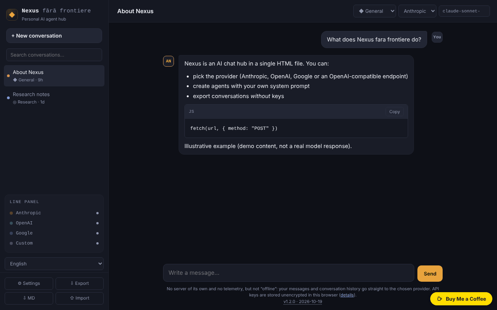

# Nexus fără frontiere

**English** · [Română](README.ro.md) · [Français](README.fr.md) · [Italiano](README.it.md) · [Español](README.es.md) · [Português](README.pt.md) · [Deutsch](README.de.md) · [Magyar](README.hu.md)

**Version:** 1.2.0 · **Last updated:** 2026-10-19

Interface languages: **Română, English, Français, Italiano, Español, Português (PT), Deutsch, Magyar**

A personal AI chat hub in a single HTML file: you talk directly from the browser to Anthropic, OpenAI, Google or an OpenAI-compatible endpoint. **It is not an offline app** and your keys sit in the browser, unencrypted — read the section "Privacy and network".

**Live app:** https://chiuta.github.io/Nexus-fara-frontiere/

## What it is

A chat client without a server of its own: the page has no backend, no accounts and sends no telemetry. You enter your own API keys, and requests go straight from your browser to the chosen provider. Without a network and without a key you cannot talk to any model.

## Features

Verified in the code and, where it says "test", in a headless browser (Chromium/Playwright) with **mocked** responses — I did not run real calls against the providers' APIs.

- Four providers: Anthropic (Messages API), OpenAI (Chat Completions), Google (Gemini `generateContent`) and "Custom" (any OpenAI-compatible endpoint: Ollama, LM Studio, OpenRouter, etc.).
- SSE streaming for Anthropic and for OpenAI/compatible (test). **Google does not stream**: the response appears whole, at the end.
- "Stop" button (cancels the request; the partial text stays, marked "stopped") and automatic abort after 5 minutes without any response.
- Agents (personas): General, Code, Cowork, Research + your own agents (name, system prompt, provider, model). **"Code" and "Cowork" are only personas**: system prompts on top of the public models in the API, not integrations with the Codex or Claude Cowork products.
- Own minimal Markdown: headings, lists, bold/italic, inline code and code blocks (with "Copy"), `http(s)` links. No tables, no images. Any HTML in responses is displayed as text; `` images do not load, so a response cannot trigger requests to third parties (tested with payloads: ``, `javascript:`, raw HTML, `<script>`, `<svg onload>`, `<iframe>`).
- Multiple conversations in `localStorage`, editable title, deletion; sidebar search by title and text (diacritics- and case-insensitive).
- "⇩ MD" saves the current conversation as a Markdown file (no keys; a key that appears in the text is masked); printing (Ctrl+P) produces only the current conversation, on a white background.
- JSON export/import (conversations and agents, **without keys**), with sanitisation of the imported file.
- The model list is editable and can be reloaded from the provider's API, with your key.
- "Delete key" per provider and "Delete all local data".
- First-use guidance: the empty state points to the missing API key and opens Settings from a button; typed text is not lost if the key is missing.
- Explicit error messages for 401, 403, 404, 429 (with `Retry-After` if the provider exposes it), 5xx, errors in the middle of the stream and network/CORS/CSP (test).

## User guide

1. Open the page (or `index.html` locally) and press **⚙ Settings**.
2. Read the warning at the top, then paste the API key for the provider you want (the "show" button reveals it). Use a dedicated key with a spending limit.
3. Press **Test connection** (it makes a minimal request and aborts it at the first text fragment).
4. If the suggested model name no longer exists, press **Update model list** or type the name directly into the "Model" field.
5. Close Settings, press **+ New conversation**, choose the agent, provider and model from the top bar and write the message (Enter sends, Shift+Enter new line).
6. **Stop** interrupts a response in progress.
7. **Export** saves the conversations and agents into a JSON file; **Import** adds them (does not replace) from a file. Import only files you trust: the prompt of an imported agent influences the model's responses.

## Privacy and network

**What stays in the browser**
- `localStorage`: conversations, agents, settings and **API keys, in clear text (unencrypted)**. If `localStorage` is blocked or full (e.g. private mode), the app runs in memory and warns you that nothing is saved.
- Keys can be read by anyone with access to the browser profile, by malicious extensions or by a possible XSS. Measures taken: CSP (below), all content in responses is escaped, import is sanitised. They do not eliminate the risk: do not use the app on public/shared computers, use dedicated keys and revoke them if in doubt.
- The export contains no keys (verified; if a saved key nevertheless appears in the text of a conversation, it is masked on export). Exported conversations may contain anything you wrote.

**What leaves the browser and where** (only when you send a message, test the connection or update the model list)
- Anthropic: `https://api.anthropic.com/v1/messages` and `/v1/models`. The key goes in the `x-api-key` header.
- OpenAI: `https://api.openai.com/v1/chat/completions` and `/v1/models`. `Authorization: Bearer …` header.
- Google: `https://generativelanguage.googleapis.com/v1beta/models/<model>:generateContent` and `/v1beta/models`. The key goes in the `x-goog-api-key` header (not in the URL).
- Custom: your URL + `/v1/chat/completions` and `/v1/models`; the key, if you set one, goes as a Bearer to that URL. `http://` is accepted only for `localhost`/`127.0.0.1`.
- With each message the following are sent to the provider: the key, the agent's system prompt and the conversation history (the last 100 messages, at most ~300,000 characters; if truncated, the app tells you). The chosen provider's data policies apply.
- There are no other hosts: no telemetry, no CDN, no external font or script. Links in responses open only on click (`noopener noreferrer`), and the page requests `referrer: no-referrer`.

**The `anthropic-dangerous-direct-browser-access` header**: the Anthropic API refuses CORS calls from the browser by default, precisely because a key in a web page is risky. The header is your explicit confirmation that you accept this risk. The app sends it because otherwise it cannot talk to Anthropic from a single HTML file.

**Content-Security-Policy** (in `<meta>`): scripts are allowed only on the basis of the page script's hash (no `<script>` injection runs); `connect-src` is limited to the three APIs plus `localhost`/`127.0.0.1` (any port); no external images, fonts, iframes or forms. Inline styles are allowed (`style-src 'unsafe-inline'`), because the app generates `style` attributes.

### External custom endpoint (OpenRouter, DeepSeek, Mistral, etc.)

With the shipped CSP, a custom endpoint works only on `localhost`/`127.0.0.1`. For an external host, the CSP must be relaxed — and that weakens key protection (an injected script could send the keys to that host, as long as the script can run; the hash in `script-src` prevents it, but the defence is single-layered). If you still want to:

1. Download `index.html` and open it in an editor.
2. In the `<meta http-equiv="Content-Security-Policy" …>` tag add your host to `connect-src`, for example `https://openrouter.ai`.
3. **Do not modify anything in the `<script>` block**: the hash in the CSP would no longer match and the page will not start. If you modify the script, recompute the SHA-256 hash and replace it in `script-src`.
4. Open the file locally (or publish your own copy).

For Ollama: start it with the `OLLAMA_ORIGINS` variable set to the page's origin (e.g. `https://chiuta.github.io`), otherwise the browser blocks the response (CORS). From the page published over HTTPS, `http://localhost` is allowed by browsers as an exception; a local network address `http://192.168.x.x` is not.

## Limits and warnings

- Model names change often. The suggestions in the app (Anthropic: `claude-sonnet-5-5`, `claude-opus-5-5`, `claude-haiku-5-5`, `claude-fable-5-1`; OpenAI: `gpt-6-astra`, `gpt-6.1-sol`, `gpt-6-luna`; Google: `gemini-3.8-flash`, `gemini-3.1-pro-preview`, `gemini-3.5-flash`, `gemini-3.1-flash-lite`) were checked manually in the official documentation on 2026-10-08 and may be out of date; I do not guarantee their availability for your account, nor the prices. If you used an older version, the models saved in Settings and in old conversations may no longer exist: change them.
- I did not test with the real APIs (I used only mocked responses). Real provider peculiarities (CORS on certain endpoints, parameters rejected by some models) may appear.
- Fixed limit of 4096 output tokens for Anthropic. No tool calls, no attachments/images, no web search.
- Long conversations: only the last messages are sent (see above); `localStorage` is usually ~5 MB — when exceeded you get a warning and conversations are no longer saved: export them.
- A model's response may be wrong, made up or inappropriate; check it before relying on it. The text of a displayed link may differ from the real address (the address appears on hover, in `title`).
- The costs of the calls are yours; the app does not limit spending.
- Personal project, offered "as is", without warranties.

## Running locally / offline

Download `index.html` and open it in a browser. The page starts without internet, but the chat requires a network (or a local model, e.g. Ollama on `localhost`).

## History / Changelog

### 1.1.0 — 2026-10-14
- Backup and data labelling (fff-kit).

### 1.0.0 — 12 October 2026
- The version and the date of the last update are displayed in the app (below the message field).

### 11.10.2026 (third update) — 11 October 2026
- Fixed: if you sent the first message without an API key (or without an endpoint/model), the typed text was lost; now it stays in the input field, and the notification says so.
- The empty state shows a starting step with an "Open Settings" button as long as no provider has a saved key (or endpoint); it disappears once you add one.

### 11.10.2026 (second update) — 11 October 2026
- Search in conversations (title and text), export of the current conversation to Markdown and a print style for the conversation.

### 11.10.2026 — 11 October 2026
- Accessibility: a single h1 heading in the main area (the one in the sidebar was hidden on mobile); axe check with no violations at 1280 and 360 px.
- The model suggestions remain those verified on 2026-10-08 (the date appears in the app); they were not re-verified on 11.10.2026 — check the list in Settings or with "Update model list".

## License

MIT — see the LICENSE file.

## Author

Alexio — Alexandru-Ionuț Chiuță, contact: alexio@trom.tf

## Summary

Nexus fără frontiere is a single-file, Romanian-language multi-provider AI chat client: Anthropic, OpenAI, Google Gemini or any OpenAI-compatible endpoint, called directly from your browser (SSE streaming for Anthropic and OpenAI-compatible; Gemini is non-streaming). It has no server and no telemetry, but it is not offline: messages and history go straight to the provider you choose, and API keys are stored unencrypted in localStorage. A strict CSP limits connections to the three APIs plus localhost; external custom endpoints require editing the CSP in a local copy (documented). Markdown is rendered by a small escaping renderer (tested against XSS payloads); export contains no keys. "Code" and "Cowork" are personas, not integrations. Tested only with mocked API responses.
