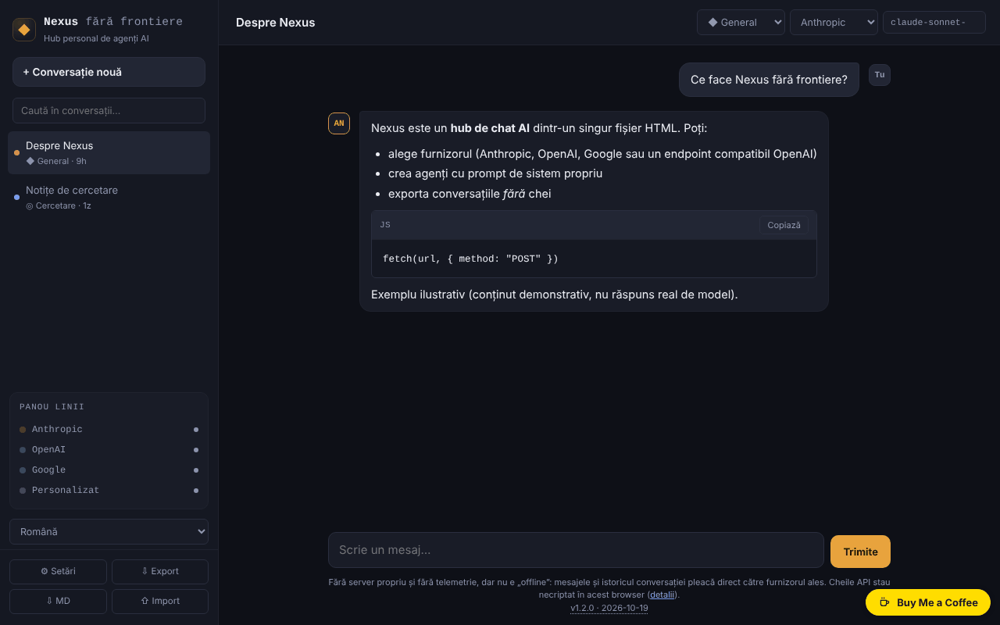

# Nexus fără frontiere

[English](README.md) · **Română** · [Français](README.fr.md) · [Italiano](README.it.md) · [Español](README.es.md) · [Português](README.pt.md) · [Deutsch](README.de.md) · [Magyar](README.hu.md)

**Versiune:** 2.1.0 · **Ultima actualizare:** 2026-10-27

Limbile interfeței: **Română, English, Français, Italiano, Español, Português (PT), Deutsch, Magyar**

**Stare:** stabilă (2.1.0). Criptarea opțională cu parolă a cheilor API este nouă și **nu a fost auditată de un terț**.

**Offline:** nu. Interfața se încarcă offline după prima vizită, dar orice mesaj cere conexiune la furnizorul ales (sau la un endpoint local, de ex. Ollama).

Hub personal de chat AI într-un singur fișier HTML: vorbești direct din browser cu Anthropic, OpenAI, Google sau cu un endpoint compatibil OpenAI. **Nu este o aplicație offline** și cheile tale stau în browser, implicit necriptate (criptare opțională cu parolă din 2.1.0) — citește secțiunea „Confidențialitate și rețea”.

**Live:** https://chiuta.github.io/Nexus-fara-frontiere/

## Ce este

Un client de chat fără server propriu: pagina nu are backend, nu are conturi și nu trimite telemetrie. Tu îți introduci propriile chei API, iar cererile pleacă direct din browserul tău către furnizorul ales. Fără rețea și fără cheie nu poți vorbi cu niciun model.

## Funcții

Verificate în cod și, unde scrie „test”, într-un browser headless (Chromium/Playwright) cu răspunsuri **simulate** — nu am rulat apeluri reale către API-urile furnizorilor.

- **Fluxuri de agenți (2.0):** în ⛓ Fluxuri construiești un lanț de pași (instrucțiune către model, unealtă locală, verificare cu reluare/oprire/avertisment), îl rulezi local pas cu pas și primești un jurnal complet (exportabil .md). Limite: 12 pași, 20 apeluri la model, 3 reluări. Șabloane exportabile/importabile (JSON, fără chei). Instrucțiunile trimit textul către furnizorul conversației curente; uneltele și verificările rămân în browser.
- Patru furnizori: Anthropic (Messages API), OpenAI (Chat Completions), Google (Gemini `generateContent`) și „Personalizat” (orice endpoint compatibil OpenAI: Ollama, LM Studio, OpenRouter etc.).
- Streaming SSE pentru Anthropic și pentru OpenAI/compatibile (test). **Google nu face streaming**: răspunsul apare întreg, la final.
- Buton „Oprește” (anulează cererea; textul parțial rămâne, marcat „oprit”) și întrerupere automată după 5 minute fără niciun răspuns.
- Agenți (persona): General, Cod, Cowork, Cercetare + agenți proprii (nume, prompt de sistem, furnizor, model). **„Cod” și „Cowork” sunt doar persona**: prompturi de sistem peste modelele publice din API, nu integrări cu produsele Codex sau Claude Cowork.
- Markdown propriu, minimal: titluri, liste, bold/italic, cod inline și blocuri de cod (cu „Copiază”), linkuri `http(s)`. Fără tabele, fără imagini. Orice HTML din răspunsuri este afișat ca text; imaginile `` nu se încarcă, deci un răspuns nu poate declanșa cereri către terți (test cu payload-uri: ``, `javascript:`, HTML brut, `<script>`, `<svg onload>`, `<iframe>`).
- Conversații multiple în `localStorage`, titlu editabil, ștergere; căutare în bara laterală după titlu și text (insensibilă la diacritice și majuscule).
- „⇩ MD” salvează conversația curentă ca fișier Markdown (fără chei; o cheie apărută în text e mascată); tipărirea (Ctrl+P) produce doar conversația curentă, pe fundal alb.
- Export/import JSON (conversații și agenți, **fără chei**), cu sanitizarea fișierului importat.
- Lista de modele editabilă și reîncărcabilă din API-ul furnizorului, cu cheia ta.
- „Șterge cheia” per furnizor și „Șterge toate datele locale”.
- Ghidare la prima utilizare: starea goală indică lipsa cheii API și deschide Setările dintr-un buton; textul tastat nu se pierde dacă lipsește cheia.
- Mesaje de eroare explicite pentru 401, 403, 404, 429 (cu `Retry-After` dacă furnizorul îl expune), 5xx, erori în mijlocul stream-ului și rețea/CORS/CSP (test).

## Manual de utilizare

1. Deschide pagina (sau `index.html` local) și apasă **⚙ Setări**.
2. Citește avertismentul de sus, apoi lipește cheia API pentru furnizorul dorit (butonul „arată” o dezvăluie). Folosește o cheie dedicată, cu limită de cheltuieli.
3. Apasă **Testează conexiunea** (face o cerere minimă și o întrerupe la primul fragment de text).
4. Dacă numele de model sugerat nu mai există, apasă **Actualizează lista de modele** sau scrie direct numele în câmpul „Model”.
5. Închide Setările, apasă **+ Conversație nouă**, alege agentul, furnizorul și modelul din bara de sus și scrie mesajul (Enter trimite, Shift+Enter rând nou).
6. **Oprește** întrerupe un răspuns în curs.
7. **Export** salvează conversațiile și agenții într-un fișier JSON; **Import** le adaugă (nu înlocuiește) din fișier. Importă doar fișiere în care ai încredere: promptul unui agent importat influențează răspunsurile modelului.

## Confidențialitate și rețea

**Ce rămâne în browser**
- `localStorage`: conversațiile, agenții, setările și **cheile API, în clar (necriptate)**. Dacă `localStorage` e blocat sau plin (ex. mod privat), aplicația merge în memorie și te avertizează că nu se salvează nimic.
- Cheile pot fi citite de oricine are acces la profilul browserului, de extensii rău intenționate sau de un eventual XSS. Măsuri luate: CSP (mai jos), tot conținutul din răspunsuri este escapat, importul e sanitizat. Nu elimină riscul: nu folosi aplicația pe calculatoare publice/partajate, folosește chei dedicate și revocă-le dacă ai dubii.
- Exportul nu conține chei (verificat; dacă o cheie salvată apare totuși în textul unei conversații, e mascată la export). Conversațiile exportate pot conține orice ai scris tu.

**Ce pleacă din browser și unde** (doar când trimiți un mesaj, testezi conexiunea sau actualizezi lista de modele)
- Anthropic: `https://api.anthropic.com/v1/messages` și `/v1/models`. Cheia merge în antetul `x-api-key`.
- OpenAI: `https://api.openai.com/v1/chat/completions` și `/v1/models`. Antet `Authorization: Bearer …`.
- Google: `https://generativelanguage.googleapis.com/v1beta/models/<model>:generateContent` și `/v1beta/models`. Cheia merge în antetul `x-goog-api-key` (nu în URL).
- Personalizat: URL-ul tău + `/v1/chat/completions` și `/v1/models`; cheia, dacă o pui, merge ca Bearer la acel URL. `http://` e acceptat doar pentru `localhost`/`127.0.0.1`.
- La fiecare mesaj se trimit furnizorului: cheia, promptul de sistem al agentului și istoricul conversației (ultimele 100 de mesaje, maximum ~300.000 de caractere; dacă e trunchiat, aplicația te anunță). Se aplică politicile de date ale furnizorului ales.
- Nu există alte gazde: nicio telemetrie, niciun CDN, niciun font sau script extern. Linkurile din răspunsuri se deschid doar la click (`noopener noreferrer`), iar pagina cere `referrer: no-referrer`.

**Antetul `anthropic-dangerous-direct-browser-access`**: API-ul Anthropic refuză implicit apelurile CORS din browser, tocmai pentru că o cheie într-o pagină web e riscantă. Antetul este confirmarea explicită, din partea ta, că accepți acest risc. Aplicația îl trimite pentru că altfel nu poate vorbi cu Anthropic dintr-un singur fișier HTML.

**Content-Security-Policy** (în `<meta>`): scripturile sunt permise doar pe baza hash-ului scriptului din pagină (nicio injecție de `<script>` nu rulează); `connect-src` este limitat la cele trei API-uri plus `localhost`/`127.0.0.1` (orice port); fără imagini, fonturi, iframe-uri sau formulare externe. Stilurile inline sunt permise (`style-src 'unsafe-inline'`), pentru că aplicația generează atribute `style`.

### 1.2.1 — 2026-10-22
- Titlul paginii și meta tag-urile de descriere/Open Graph urmează limba interfeței.

### Endpoint personalizat extern (OpenRouter, DeepSeek, Mistral etc.)

Cu CSP-ul livrat, un endpoint personalizat funcționează doar pe `localhost`/`127.0.0.1`. Pentru un host extern, CSP-ul trebuie relaxat — iar asta slăbește protecția cheilor (un script injectat ar putea trimite cheile către acel host, cât timp scriptul poate rula; hash-ul din `script-src` îl împiedică, dar apărarea e pe un singur strat). Dacă vrei totuși:

1. Descarcă `index.html` și deschide-l într-un editor.
2. În eticheta `<meta http-equiv="Content-Security-Policy" …>` adaugă gazda ta la `connect-src`, de exemplu `https://openrouter.ai`.
3. **Nu modifica nimic în blocul `<script>`**: hash-ul din CSP ar înceta să se potrivească și pagina nu va mai porni. Dacă modifici scriptul, recalculează hash-ul SHA-256 și înlocuiește-l în `script-src`.
4. Deschide fișierul local (sau publică-ți propria copie).

Pentru Ollama: pornește-l cu variabila `OLLAMA_ORIGINS` setată la originea paginii (ex. `https://chiuta.github.io`), altfel browserul blochează răspunsul (CORS). Din pagina publicată prin HTTPS, `http://localhost` e permis de browsere ca excepție; o adresă de rețea locală `http://192.168.x.x` nu este.

## Criptare cu parolă a cheilor API (din 2.1.0, opțională)

În ⚙ Setări există un card „Protecție cu parolă”. **Implicit e oprită**: cheile rămân în `localStorage` în clar, ca mai sus.

- Când o activezi, cheile introduse sunt criptate cu **AES-256-GCM**, cu o cheie derivată din parola ta prin **PBKDF2-SHA256, 600 000 de iterații și sare aleatoare de 16 octeți**, și păstrate într-un singur plic în `nexus:aik-vault`. Setările din `nexus:settings` nu mai conțin atunci nicio cheie. Copia în clar se înlocuiește abia după ce plicul a fost citit înapoi și decriptat cu succes (migrare fără pierdere). „Dezactivează protecția” readuce cheile în setările obișnuite, după confirmarea parolei.
- La deschidere aplicația cere parola (poți închide dialogul; cheile rămân indisponibile și se pot debloca din Setări). Cheile deblocate stau doar în memorie; „Blochează acum” le scoate.
- **Limite spuse deschis:** componenta e mică și **nu a fost auditată de un terț**; parola nu se poate recupera (dacă o uiți, reintroduci cheile); nu protejează împotriva unui script rău-intenționat sau a unei extensii care rulează în pagină cât timp cheile sunt deblocate; o parolă scurtă poate fi ghicită offline. Textele cardului există în română și engleză (celelalte limbi folosesc engleza).
- „Șterge toate datele locale” șterge și seiful. Teste: `node tests/keyvault-core.test.mjs` și `node tests/keyvault-ui.test.mjs`.

## Nexus fără frontiere față de AI Liber

Ambele sunt interfețe de chat single-file și se suprapun la partea „chat cu propria cheie API”; sunt ținute separat intenționat. **Nexus** e unealta de lucru pentru cine are deja chei: agenți (persone), fluxuri de agenți, Anthropic / OpenAI / Google / „Custom”. **AI Liber** e poarta de intrare: modele gratuite fără cont (Pollinations, DuckDuckGo, AI Horde), ghid de AI-uri gratuite, quiz, idei de prompturi, WebLLM în browser și mai mulți furnizori (Groq, Mistral, OpenRouter, Perplexity...), dar fără agenți și fluxuri. Vezi și: https://chiuta.github.io/AI-Liber/

## Limite și avertismente

- Numele modelelor se schimbă des. Sugestiile din aplicație (Anthropic: `claude-sonnet-5-5`, `claude-opus-5-5`, `claude-haiku-5-5`, `claude-fable-5-1`; OpenAI: `gpt-6-astra`, `gpt-6.1-sol`, `gpt-6-luna`; Google: `gemini-3.8-flash`, `gemini-3.1-pro-preview`, `gemini-3.5-flash`, `gemini-3.1-flash-lite`) au fost verificate manual în documentațiile oficiale la 2026-10-08 și pot fi depășite; nu garantez disponibilitatea lor pentru contul tău, nici tarifele. Dacă ai folosit o versiune mai veche, modelele salvate în Setări și în conversații vechi pot fi inexistente: schimbă-le.
- Nu am testat cu API-urile reale (am folosit doar răspunsuri simulate). Particularități reale ale furnizorilor (CORS pe anumite endpoint-uri, parametri respinși de unele modele) pot apărea.
- Limită fixă de 4096 tokeni de ieșire la Anthropic. Fără apeluri de unelte, fără atașamente/imagini, fără căutare web.
- Conversațiile lungi: se trimit doar ultimele mesaje (vezi mai sus); `localStorage` are de obicei ~5 MB — la depășire primești avertisment și conversațiile nu se mai salvează: exportă-le.
- Un răspuns de model poate fi greșit, inventat sau nepotrivit; verifică-l înainte să te bazezi pe el. Textul unui link afișat poate diferi de adresa reală (adresa apare la trecerea cursorului, în `title`).
- Costurile apelurilor sunt ale tale; aplicația nu limitează cheltuielile.
- Proiect personal, oferit „ca atare”, fără garanții.

## Rulare locală / offline

Descarcă `index.html` și deschide-l în browser. Pagina pornește fără internet, dar chat-ul cere rețea (sau un model local, ex. Ollama pe `localhost`).

## Istoric / Changelog

### 1.2.5 — 2026-10-22

fff-kit 1.1.4: ținte tactile și text minim.

### 1.2.4 — 2026-10-22

fff-kit 1.1.2: PBKDF2 600 000 iterații, protecție anti-clickjacking.

- 1.2.3 — 2026-10-22: Cele două window.confirm (ștergere conversație, ștergere date) sunt înlocuite cu dialoguri în pagină; titlurile din răspunsurile modelului nu mai creează h1/h2 suplimentare în pagină; text ≥ 12 px și linkuri mai late în subsol pe mobil.

- 1.2.2 — 2026-10-22: **remediere**: textul exemplu din câmpul „URL bază” („sau”) urmează acum limba aleasă.
### 1.1.0 — 2026-10-14
- Copie de rezervă și etichetare date (fff-kit).

### 1.0.0 — 12 octombrie 2026
- Versiunea și data ultimei actualizări sunt afișate în aplicație (sub câmpul de mesaj).

### 11.10.2026 (a treia actualizare) — 11 octombrie 2026
- Corectat: dacă trimiteai primul mesaj fără cheie API (sau fără endpoint/model), textul tastat se pierdea; acum rămâne în câmpul de scris, iar notificarea spune asta.
- Starea goală arată un pas de pornire cu buton „Deschide Setări” cât timp niciun furnizor nu are cheie (sau endpoint) salvată; dispare după ce adaugi una.

### 11.10.2026 (a doua actualizare) — 11 octombrie 2026
- Căutare în conversații (titlu și text), export al conversației curente în Markdown și stil de tipărire pentru conversație.

### 11.10.2026 — 11 octombrie 2026
- Accesibilitate: un singur titlu h1 în zona principală (cel din bara laterală era ascuns pe mobil); verificare axe fără încălcări la 1280 și 360 px.
- Sugestiile de modele rămân cele verificate la 2026-10-08 (data apare în aplicație); nu au fost reverificate pe 11.10.2026 — verifică lista în Setări sau cu „Actualizează lista de modele”.

## Licență

MIT — vezi fișierul LICENSE.

## Autor

Alexio — Alexandru-Ionuț Chiuță, contact: alexio@trom.tf

## Rezumat

Nexus fără frontiere este un client de chat AI multi-furnizor într-un singur fișier, în limba română: Anthropic, OpenAI, Google Gemini sau orice punct final compatibil OpenAI, apelate direct din browser (streaming SSE pentru Anthropic și compatibil OpenAI; Gemini nu face streaming). Nu are server și nici telemetrie, dar nu este offline: mesajele și istoricul merg direct la furnizorul ales, iar cheile API se stochează necriptat în localStorage. Un CSP strict limitează conexiunile la cele trei API-uri plus localhost; punctele finale personalizate externe necesită editarea CSP într-o copie locală (documentat). Markdown este redat de un mic randator cu escapare (testat împotriva sarcinilor XSS); exportul nu conține chei. „Code” și „Cowork” sunt personaje, nu integrări. Testat doar cu răspunsuri API simulate.
